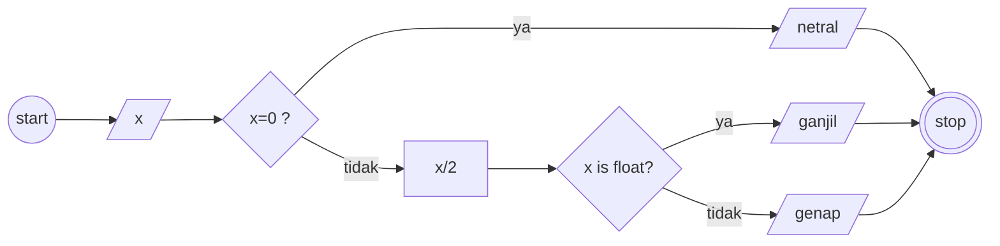

# Algoritma

## Soal 1: Memindahkan Air
- Memindahkan air di dalam gelas.
- Gelas A berisikan teh.
- Gelas B berisikan kopi.
- Isi Gelas A dipindahkan ke Gelas B dan sebaliknya tanpa mencampur.

### Penyelesaian Deskriptif
1. Mulai
2. Siapkan Gelas A dan Gelas B
3. Siapkan Gelas X (gelas tambahan)
4. Tuangkan isi Gelas A ke Gelas X
5. Tuangkan isi Gelas B ke Gelas A
6. Tuangkan isi Gelas X ke Gelas A
7. Selesai

## Soal 2: Bilangan Ganjil atau Genap
- Membuat algoritma menentukan bilangan ganjil atau genap.

### Penyelesaian Deskriptif
1. Mulai
2. Apabila bilangan bernilai 0, maka hasilnya netral
3. Bilangan dibagi dengan angka 2
4. Apabila bilangan menjadi bentuk desimal, maka hasilnya adalah bilangan ganjil
5. Apabila bilangan bukan bilangan ganjil, maka hasilnya adalah bilangan genap
6. Selesai

### Flowchart

## Soal 3: Luas dan Keliling Lingkaran
- Membuat algoritma menghitung luas dan keliling lingkaran.

### Penyelesaian Deskriptif
1. Mulai
2. Menghitung jari-jari lingkaran (r)
3. Mengalikan jari-jari lingkaran (r) dengan jari-jari lingkaran (r) dan dikalikan lagi dengan nilai 3.14 (pi) untuk menghasilkan luas lingkaran
4. Mengalikan jari-jari lingkaran (r) dengan nilai 3.14 (pi) dan dikalikan lagi dengan angka 2 untuk menghasilkan keliling lingkaran
5. Selesai

<!-- 
(()) start
((())) stop
[] process
{} decision
[//] input/output
-->